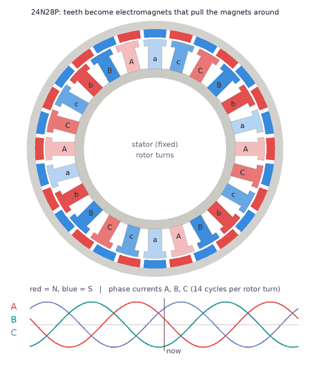

# BLDC Actuator 19 Nm Prototype (9:1)

CAD and design files for a DIY robotic actuator: a custom BLDC motor, a 9:1 gearbox and an FOC controller, for precision robot arm joints. Developed in three phases, one folder each.

*24N28P motor: each stator tooth's polarity follows the three phase currents and pulls the rotor magnets around. Interactive version: [`bldc_v1_rotor_flux_animation.html`](phase1-motor/n52/animation/bldc_v1_rotor_flux_animation.html) (download and open in a browser).*

| Phase | Folder | Status |
|---|---|---|
| 1. BLDC motor (stator, rotor, magnets, winding) | [phase1-motor/](phase1-motor/README.md): [`n52/`](phase1-motor/n52/README.md) (18 mm stack, arc magnets) and [`n35/`](phase1-motor/n35/README.md) (20 mm stack, 28 × 20×5×2 N35) | Not started. Stator files ready for both variants; N35 has its own rotor, hub, can and assemblies; N52 uses the v2 parts in phase2-gearbox |
| 2. 9:1 cycloidal gearbox (actuator v2, flipped motor) | [phase2-gearbox/](phase2-gearbox/README.md) | Not built (v2 CAD, drawings and clearance checks ready) |
| 3. FOC controller (ODrive-class board first, custom PCB later) | [phase3-foc-controller/](phase3-foc-controller/README.md) | Not started |

Design notes, decisions and status live in the knowledge base: [engineering-assistant / BLDC_ACTUATOR.md](https://github.com/aadhi4200/engineering-assistant/blob/main/projects/electronics/BLDC_ACTUATOR.md).

## Conventions

- Units: mm. Z = actuator axis.
- File names: `bldc_v<N>_<part>_<key dims>_<material>.<ext>`.
- Each phase keeps the same layout where it applies: `dxf/`, `step/`, `fusion360_import/`, `previews/`, `scripts/`.
- Generated files are rebuilt from each phase's `scripts/`; edit the parameters, not the outputs.
