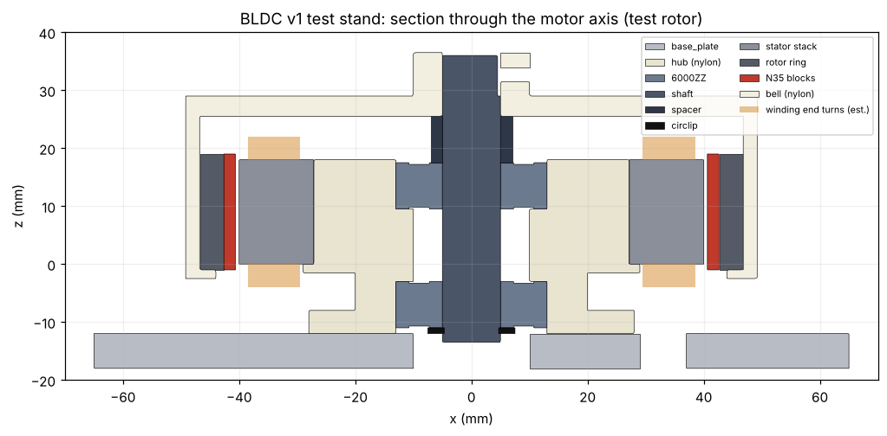
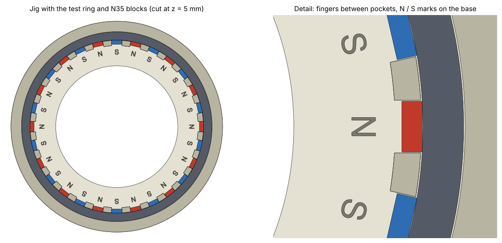

# Phase 1: BLDC Motor (v1 motor core CAD)

CAD for the v1 motor of the DIY 9:1, 19 Nm BLDC actuator: a 24N28P outrunner with an 80 mm laminated mild steel stator and a 0.7 mm air gap.

Design record: [ADR 0002 in engineering-assistant](https://github.com/aadhi4200/engineering-assistant/blob/main/decisions/0002-bldc-v1-motor-design.md).
Status: **Phase 1 not started.** These are design files. Nothing has been cut, built or measured.

> **Actuator v2 supersedes the v1 test stand (2026-11-25).** The motor is now flipped and bolts to the cycloidal gearbox. The rotor is **one machined steel part** (back-iron cup + hub + Ø10 shaft): `act_v2_07_rotor_one_piece_steel` (final, Ø87.4 bore) and `act_v2_07b_rotor_one_piece_TEST_85.4bore` (test, Ø85.4 bore for the 10×5×2 N35 blocks), plus `act_v2_10_stator_hub` and `act_v2_11_back_plate`, all in [`phase2-gearbox/step/4_machined/`](../phase2-gearbox/README.md).
> **Still current here:** stator plate DXFs (tabbed sheet and single plate), stator stack, magnet models and magnet spec, winding, key dimensions, previews and animation.
> **Superseded, kept for reference:** the separate rotor rings, printed hub and bell, Ø10 × 49.5 shaft, spacer, base plate, the v1 test-stand assemblies and the magnet jig (made for the separate ring; the v2 rotor is a cup with a floor).

## Folders

| Folder | Contents |
|---|---|
| `dxf/` | Laser-cut files: DXF R12, `LINE` + `ARC`/`CIRCLE` only, one layer `CUT`, mm, no reference geometry |
| `dxf/backup_flat/` | Same outlines with arcs split into 0.5° straight lines, for viewers that misread arcs |
| `step/1_assemblies/` | Full test stand (test and final rotor) and motor core only (test and final rotor) |
| `step/2_print/` | Parts to 3D print |
| `step/3_laser_cut/` | Stator plate and the 18 mm stack |
| `step/4_machined/` | Rotor rings, shaft, spacer, base plate |
| `step/5_bought/` | Bearings, circlip, magnets (for reference in assemblies) |
| `fusion360_import/` | Only what you open or print in Fusion 360, plus [import steps](fusion360_import/README.md) |
| `previews/` | Top views, test-stand section, magnet jig |
| `animation/` | `bldc_v1_rotor_flux_animation.gif` (shown in the main README) and `.html` (interactive: download and open in a browser) |
| `scripts/` | Generator: every file above is rebuilt from `params.py` |

## Files

### Laser cut (order these)

| File | What | Qty |
|---|---|---|
| `dxf/bldc_v1_stator_plate_24N28P_80mm_ms1mm_x20_tabbed_sheet_351x434.dxf` | **Sent to Robu for a quote:** 20 stator plates on one 351 × 434 mm sheet, 0.8 mm tabs on teeth 7 and 19. Snap out, file the stubs, true the stack OD | 1 sheet |
| `dxf/bldc_v1_stator_plate_24N28P_80mm_ms1mm.dxf` | Single stator plate, 1 mm mild steel | 20 (18 + 2 spare) if not tabbed |
| `dxf/bldc_v1_rotor_ring_final_93.4x87.4x20_ms.dxf` / `..._test_93.4x85.4x20_ms.dxf` | Rotor ring profiles (rings are lathe-turned solid; DXF is the profile reference) | 1 each |

### 3D print (`step/2_print/`)

| File | What | Material |
|---|---|---|
| `bldc_v1_test_stand_hub_51.95x30_nylon.step` | Hub: stator seat with key ribs, 2 bearing bores, M4 heat-set insert holes | MJF nylon |
| `bldc_v1_rotor_bell_98.4_nylon.step` | Rotor bell: holds the ring on a bottom lip, M3 set-screw boss | Nylon |
| `bldc_v1_magnet_jig_test_rotor_28pocket_print.step` | Magnet gluing jig for the N35 test rotor (removable) | PLA or PETG |

### Machined (`step/4_machined/`)

| File | What |
|---|---|
| `bldc_v1_rotor_ring_test_93.4x85.4x20_ms.step` | Test rotor ring, solid mild steel |
| `bldc_v1_rotor_ring_final_93.4x87.4x20_ms.step` | Final rotor ring, solid mild steel |
| `bldc_v1_shaft_10x49.5_steel.step` | Ø10 × 49.5 mm shaft, DIN 471 groove, set-screw flat |
| `bldc_v1_spacer_14x10x8.step` | Spacer between the upper bearing inner race and the bell |
| `bldc_v1_test_stand_base_plate_130x130x6.step` | Base plate (aluminium or steel) |

### Bought (`step/5_bought/`)

2 × 6000ZZ bearings, 1 × DIN 471 circlip for Ø10, 56 × N35 10×5×2 blocks (test), 28 × arc magnets N48SH (final, custom order).

### Assemblies (`step/1_assemblies/`)

| File | What |
|---|---|
| `bldc_v1_test_stand_assembly_test_rotor.step` | **Complete test stand with the N35 test rotor** (named components) |
| `bldc_v1_test_stand_assembly_final_rotor.step` | Complete test stand with the final rotor |
| `bldc_v1_motor_core_test_rotor.step` / `..._final_rotor.step` | Stator stack + ring + magnets only |

## Key dimensions (from `scripts/params.py`)

**Frozen for v1 (2026-11-24):** the stator and rotor dimensions below are fixed. Other parts (test stand, housing, gearbox) are designed around them.

| Item | Value |
|---|---|
| Stator | 80 mm OD, 52 mm bore, 3.5 mm yoke, 24 teeth × 4.8 mm, slot depth 8.2 mm, slot opening 2.0 mm, slot area ≈32.8 mm² |
| Alignment notches | 3 × 1.2 mm in the bore under teeth 1 and 13 |
| Stack | 18 × 1 mm, ≈283 g mild steel (calculated) |
| Final rotor | 28 arc magnets, 3 mm thick, 18 mm long, inner R 40.7 mm, 85 % pole arc; ring 93.4 × 87.4 × 20 mm |
| Test rotor | 56 × 10×5×2 mm N35 blocks, 2 per pole axially; ring 93.4 × 85.4 × 20 mm |
| Air gap | 0.70 mm (final arcs); 0.63 mm minimum with the flat test blocks, whose corners touch the ring bore |

## Magnets: what to buy and how they sit

| | Test rotor | Final rotor |
|---|---|---|
| Magnet | **10 × 5 × 2 mm N35 block** (length × width × thickness) | Arc, **N48SH** (N42SH minimum), custom order |
| Quantity | **56** (2 per pole, stacked axially) + spares: buy 60–100 | **28** + spares |
| Orientation | 10 mm along the motor axis, 5 mm around the circle, 2 mm radial (magnetised through the 2 mm) | 18 mm along the axis, 10.93° of arc (≈8.3 mm), 3 mm radial (magnetised radially) |
| Ring / bore | Ø85.4 | Ø87.4 |
| Inner face | ≈R40.63 at the block centre (flat block in a round bore) | R40.7 |
| Air gap to stator | **0.63 mm** at the block centre, ≈0.70 mm at its edges | **0.70 mm** |
| Centre-to-centre spacing | 12.857° (360 / 28), ≈9.4 mm | same |
| Gap between neighbours | **4.13 mm** at the inner edge, **4.58 mm** at the outer edge | **1.37 mm** at R40.7, **1.47 mm** at R43.7 |
| Polarity | Alternating N / S facing the centre; both blocks of a pole the same way | Alternating N / S |

**Width is the limit.** 28 poles leave ≈9.4 mm per pole, so a test block must be **≤ about 8 mm wide** (5 mm is the design value; wider flat blocks also sit closer to the stator in the middle). Blocks longer than 20 mm stick out past the stack. For example, **25 × 10 × 2 mm bars do not fit**: 28 × 10 mm is more than the ≈268 mm bore circumference. Don't cut neodymium to size (brittle, flammable dust, heat demagnetises it).

## Test stand (section)



| Item | Value |
|---|---|
| Hub | Stator seat Ø51.95 × 18 mm (z 0…18) with 2 key ribs 2.9 × 1.15 mm; shoulder Ø58 × 1.5 (stator rests on it, under the yoke only); neck Ø40; base flange Ø56 × 4; total 30 mm (z −12…18) |
| Bearings | 2 × 6000ZZ in Ø26 bores: upper z 9.5…17.5, lower z −11…−3; Ø20 step between them touches the outer races only. Nylon hub: slip fit + Loctite 638 |
| Hub fixing | 4 × M4 heat-set inserts (Ø5.6 × 6 deep) from below, on 44 mm PCD at 45° |
| Shaft | Ø10 × 49.5 mm (z −13.5…36), DIN 471 circlip under the lower bearing, 0.5 mm flat for the M3 set screw |
| Spacer | 14 × 10 × 8 mm on the upper bearing inner race |
| Bell | Ø98.4, ring pocket Ø93.6, lip Ø88 under the ring, top disc 3.5 mm at z 25.5, boss Ø20 × 7.5 with radial M3 (tap Ø2.5) |
| Base plate | 130 × 130 × 6 (top at z −12): Ø20 centre hole, 4 × M4 counterbored, Ø8 wire hole at x = 33, 4 × Ø5.5 corner holes |
| Clearances (checked by `scripts/check_test_stand.py`) | Magnets–stator 0.63 mm (test) / 0.70 mm (final); bell–winding end turns ≥ 3.5 mm (end turns assumed 4 mm); rotor–base plate 9.5 mm; no overlapping parts |

## Magnet gluing jig (test rotor)



The test ring sits on the jig's base, centred by an outer lip. 28 fingers (≈4.1 mm wide, 19 mm tall) rise inside the ring and leave a 5.2 mm pocket per pole, so neighbouring magnets can't snap together while the epoxy cures. Each pocket has a raised N or S mark: it tells you which pole must face the **centre** of the rotor.

1. Print in PLA or PETG, 0.2 mm layers, fingers upright. Test-fit one block: it should drop into a pocket with a slight gap.
2. Wipe the fingers with a thin film of wax or petroleum jelly so epoxy doesn't stick to them.
3. Put the ring on the jig (it centres on the lip). Find each block's inner face polarity with a marked reference magnet or a compass.
4. Fill pockets one at a time, alternating N / S as marked: a dab of epoxy on the back face, then slide the block down the pocket against the ring. Insert the second block of each pocket on top of the first; the two repel slightly, so hold it for a few seconds.
5. Check every pocket's polarity before the epoxy sets. Let it cure fully (24 h for slow epoxy).
6. Push the jig out axially from below. Clean any squeeze-out off the magnets' inner faces: it would eat into the 0.63 mm air gap.

## Coordinates

mm. Z = motor axis. Origin = centre of the stator stack's bottom face (stack z = 0…18). Tooth 1 on +X, teeth numbered counter-clockwise seen from +Z. Rings and test magnets span z = −1…19, arc magnets z = 0…18. Pole 1 (N) is centred on +X.

## Regenerate

```bash
# Windows PowerShell, WSL2 or Ubuntu (Python 3.10+), from the repo root
pip install -r phase1-motor/scripts/requirements.txt
python phase1-motor/scripts/build_all.py               # everything: DXF, all STEP, Fusion 360 folder
python phase1-motor/scripts/check_test_stand.py        # optional: overlap and clearance check
python phase1-motor/scripts/make_section_preview.py    # optional: preview images
python phase1-motor/scripts/make_jig_preview.py
python phase1-motor/scripts/make_animation_gif.py
```

## Not included yet

Housing and cooling (and the gearbox, which is Phase 2).

## Changes from earlier zips

- Rebuilt from the v1 plan values with a parametric script (the earlier `BLDC_v1_24N28P_files.zip` was not available).
- "Leg" naming removed: the project now targets robot arm joints, so the 87.4 mm ID ring is the **final** rotor ring.
- Test stand redesigned from the plan values: the hub became a 30 mm pedestal (was 19.5 mm) so the winding end turns clear the base plate; spacer 8 mm (was 3.5 mm) so the bell clears the end turns above the stack; shaft 49.5 mm (was 39 mm).
- All files use one scheme: `bldc_v1_<part>_<key dims>_<material>`.
