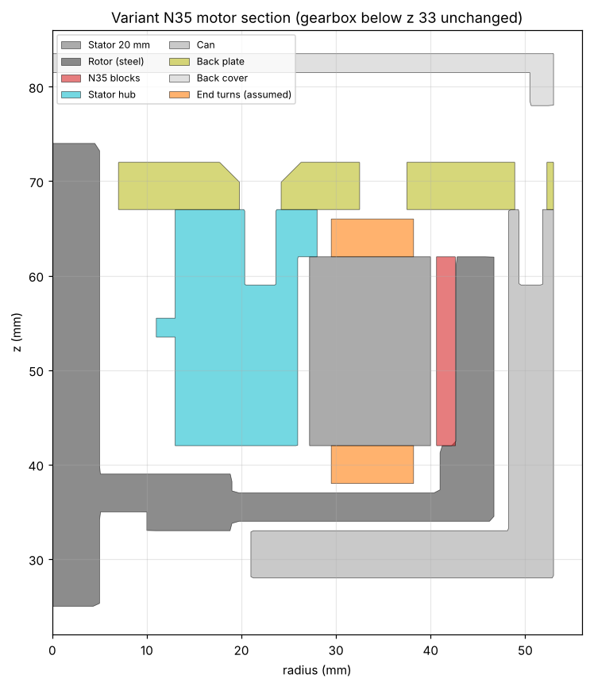

# Phase 1, variant N35: 20 mm stack + 28 × 20×5×2 N35 blocks

The cheap build of the 24N28P motor: the **same 80 mm stator plate**, stacked **20 mm** instead of 18 mm, with **one 20×5×2 mm N35 block per pole** in a one-piece steel rotor. The motor sits in the actuator v2 layout (flipped motor on the 9:1 cycloidal gearbox). The gearbox and cam are unchanged.

Status (2026-11-26): **design files only.** Nothing has been cut, built or measured. Torque and speed below are hand estimates (±30 %).



## Expected performance (estimate)

| | Motor | Output (9:1, η ≈ 0.93) |
|---|---|---|
| Peak torque | ≈1.6 Nm | **≈13 Nm** |
| Continuous torque | ≈0.35–0.45 Nm (≈0.5 with fan) | ≈3–4 Nm (≈4.5 with fan) |
| Kv (5 turns/tooth, N35 blocks) | ≈140–150 rpm/V | — |
| No-load speed at 12 V | ≈1,700 rpm | ≈190 rpm |
| No-load speed at 24 V (6S) | ≈3,500 rpm | ≈385 rpm |
| Peak phase current | ≈24 A (Kt ≈ 0.066 Nm/A) | — |
| Continuous phase current | ≈5–6 A | — |

- **Supply:** 12 V, 15 A for bench tests; 24 V (6S), 20 A for the arm. The driver must handle about 25 A peak phase current (any ODrive-class board does). With an ODrive v3.6, 12 V is at its minimum input: use a 3S LiPo or set a 12 V SMPS to about 13 V.
- **Heat:** N35 starts to lose strength above about 80 °C. Keep the winding below about 70 °C (NTC cutback).
- **Not 19 Nm.** Use this variant for the bench and first arm tests. For 19 Nm see [`../n52/`](../n52/README.md) (arc magnets) or the upgrade options below.
- The N35 blocks carry about 60 % of the arc magnets' flux, so Kv is higher and torque per amp lower than in variant N52. **Measure Kv with the generator test** (test plan step 3) before trusting these numbers.

## What changed from variant N52 / actuator v2

| Item | N52 (phase2 v2) | **N35 (this folder)** |
|---|---|---|
| Stator stack | 18 plates, z 40…58 | **20 plates, z 42…62** |
| Magnets | 28 arcs 3 × 18 mm (final) / 28 × 20×5×2 (test) | **28 × 20×5×2 N35**, z 42…62, aligned with the stack |
| Rotor 07 | Ø87.4 × 22 bore (test 07b: Ø85.4), wall to z 59 | **Ø85.4 × 20 magnet bore + Ø82 seat ledge (z 37…42)**, wall to z 62, shaft z 25…74 |
| Stator hub 10 | Ø51.9 seat z 40…60.5 | **Ø51.9 seat z 42…62 + Ø56 stator stop z 62…67** |
| Motor can 06 | wall to z 60.5 | **wall to z 67** |
| Back plate 11 / back cover 12 | z 60.5…65.5 / to z 77 | **same parts, moved up: z 67…72 / to z 83.5** |
| Envelope | Ø106 × ~82 mm | **Ø106 × 88.5 mm** |
| Gearbox, cam, bearings, output, encoder, winding | — | unchanged |

**Why 6.5 mm longer, not 2 mm:** 2 mm is the longer stack. The other 4.5 mm gives the winding end turns room. With end turns assumed 4 mm above and below the stack, they clear the rotor floor and the back plate by **1 mm** each here. In the current phase2 v2 layout (stack z 40…58, floor top z 37, back plate z 60.5) the same end turns would **hit** the rotor floor (−1 mm) and the back plate (−1.5 mm). Check that before machining the N52 / v2 parts.

**Magnet seat ledge:** the rotor bore steps to Ø82 below the magnets, so every block sits on the ledge at z 42 and lines up with the stack. The ledge clears the end turns by 2.8 mm radially. The **Ø56 stop** on the hub sets the stator's height: slide the stack up against it and epoxy.

## Clearances (checked by `scripts/build_all.py`)

| Check | Value |
|---|---|
| Overlaps: rotor, magnets, cam vs stator, end turns, hub, can, back plate, back cover, housing, ring pins | **none** |
| Air gap, magnets → stator | 0.63 mm at the block centre (≈0.70 at the edges) |
| End turns → rotor floor / back plate | 1.0 mm / 1.0 mm |
| End turns → magnet ledge / hub stop (radial) | 2.8 mm / 1.5 mm |
| Rotor OD → can ID | 1.55 mm |
| Hub bottom → rotor boss | 3.0 mm |
| Gap between neighbouring blocks | 4.1 mm |

## Files

| File | What | Qty / make |
|---|---|---|
| `dxf/bldc_v1_stator_plate_24N28P_80mm_ms1mm_x24_tabbed_sheet_351x517.dxf` | **24 stator plates on one 351 × 517 mm sheet** (20 + 4 spare), tabs on teeth 7 and 19 | 1 sheet, 1 mm mild steel |
| `dxf/bldc_v1_stator_plate_24N28P_80mm_ms1mm.dxf` | Single plate (same as N52) | 22 if not tabbed |
| `dxf/backup_flat/` | Same plate with arcs as 0.5° lines | — |
| `step/3_laser_cut/bldc_n35_stator_stack_24N28P_80mm_20mm.step` | 20 mm stack | — |
| `step/4_machined/act_n35_07_rotor_one_piece_steel_85.4bore_20mm.step` | Rotor, one piece, EN8 / C45 (≈421 g) | 1 |
| `step/4_machined/act_n35_10_stator_hub_20mm.step` | Stator hub, Al 6061 | 1 |
| `step/4_machined/act_n35_06_motor_can_20mm.step` | Motor can, Al 6061 | 1 |
| `step/4_machined/act_n35_11_back_plate.step` / `act_n35_12_back_cover.step` | Same geometry as phase2 parts 11 / 12 (only moved up) | 1 each |
| `step/5_bought/bldc_n35_magnet_block_20x5x2_N35_x28.step` | Magnet block | **28, buy 32–35** |
| `step/1_assemblies/act_n35_motor_assembly_20mm_N35.step` | Motor only (stator, rotor, 28 magnets, hub, bearings, back plate): bench test | view |
| `step/1_assemblies/act_n35_assembly_flipped_motor_cycloidal_20mm_N35.step` | **Full actuator**: this motor + the unchanged phase2 gearbox | view |
| `fusion360_import/` | Assemblies, machined parts and plate sketch for Fusion 360 ([import notes](fusion360_import/README.md)) | — |
| `previews/` | Top view with air-gap detail, motor section | — |

Unchanged parts come from [`phase2-gearbox/`](../../phase2-gearbox/README.md): housing 01, discs 02, output flange 03, retainer 04, cam 05 and all bearings. Their drawings in `act_v2_drawings.pdf` still apply. **Parts 06, 07, 10 need new drawings** for this variant (same fits as the v2 pages: Ø10 h6 journals, Ø26 J7 bearing bores, Ø20 spigot H7, Ø85.4 H7 magnet bore).

## Magnets: what to buy

| Spec | Value |
|---|---|
| Size | **20 × 5 × 2 mm** (L × W × T), ±0.1 mm |
| Grade | N35 |
| Coating | Ni-Cu-Ni |
| Magnetisation | **through the 2 mm thickness** (poles on the flat faces) |
| Quantity | 28 (one per pole), buy 32–35 |
| Orientation | 20 mm along the axis, 5 mm around the circle, alternating N / S facing the centre |

Alternative: **56 × 10×5×2** (two per pole, end to end) gives the same result. Glue one, let it set, then the second, because the two push apart.

## Assembly

1. Stator: paint both faces of every plate, stack 20 on the hub against the Ø56 stop with the notches on the hub keys, epoxy, true the OD to 80.0. Wind (5 turns/tooth × 2 strands 0.9 mm, AabBCcaABbcC × 2, star) and keep the end turns within 4 mm of the stack faces.
2. Rotor: mark each block's N face. Glue the blocks into the bore, standing on the ledge, alternating N / S. A printed 28-pocket comb (5.1 mm pockets) keeps them spaced while the epoxy cures. Clean squeeze-out off the inner faces.
3. Bench test: back plate clamped to a bracket, rotor on its shaft in the 2 × 6000, Ø10 shaft collar above the back plate for axial retention.
4. Actuator: same order as phase2 v2: gearbox → can → rotor onto cam (5 × M3) → stator unit lowered in → encoder magnet, PCB, back cover.

## Upgrade options (same rotor bore family)

| Magnets (×28, or ×56 half-length) | Bore | Output peak (est.) |
|---|---|---|
| 20×5×2 N35 (this variant) | Ø85.4 | ≈13 Nm |
| 20×5×3 N35 | Ø87.4 | ≈15 Nm |
| 20×8×3 N35 | Ø87.4 | ≈20 Nm |
| 20×8×3 N52 | Ø87.4 | ≈22 Nm |

Change `BLOCK_*` and `ROTOR_BORE` in `scripts/params.py` and rebuild. Blocks wider than about 8.5 mm do not fit 28 poles.

## Regenerate

```bash
# from the repo root, Python 3.10+
pip install -r phase1-motor/n35/scripts/requirements.txt
python phase1-motor/n35/scripts/build_all.py     # ~3-4 min; prints masses, envelope and clearance checks
```

`build_all.py` reads the gearbox geometry from `phase2-gearbox/scripts/build_v2.py`, so keep both folders together.
