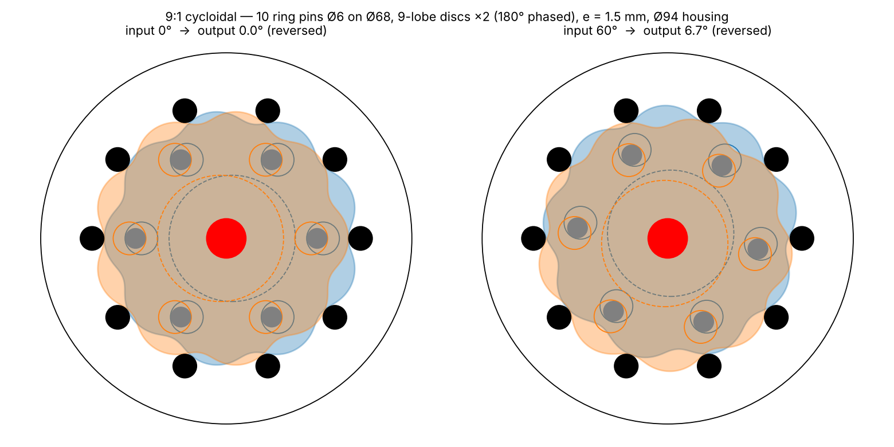
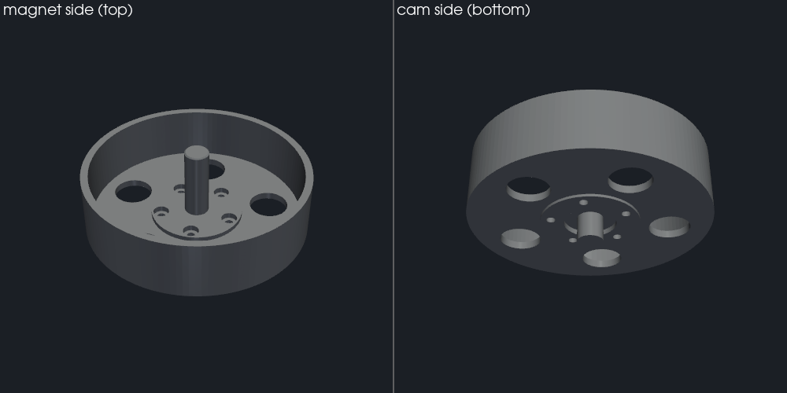

# Phase 2: 9:1 Cycloidal Gearbox — actuator v2

Single-stage **9:1 cycloidal drive** below the motor, with the **motor flipped**: the rotor faces the gearbox and bolts straight to the cam, and the stator hangs from a fixed back plate. That puts the encoder on the stationary side, on axis.



Status: **design done (CAD, drawings, clearance checks). Nothing machined or tested yet.**

## Requirements
9:1, ≥19 Nm peak output plus shock margin, ≥93 % efficiency, low backlash for arm joints, compact, mates with the 80 mm v1 motor.

## Key numbers
| Item | Value |
|---|---|
| Ratio | 9:1 (10 ring pins, 9-lobe discs). Output turns opposite to the motor. |
| Ring pins | 10 × Ø6 × 16 hardened dowels on Ø68 PCD |
| Eccentricity | 1.5 mm |
| Discs | 2 × 7 mm, 180° apart, Ø32 bore on 6804, 0.10 mm profile clearance |
| Output pins | 6 × Ø5 × 25 on Ø46 PCD (disc holes Ø8.3) |
| Output | Round Ø64 flange, **6 × M5 on Ø50 PCD**, on a 6812 bearing |
| Rotor → cam | Ø38 flange, **5 × M3 low-head on Ø30 PCD**, Ø20 spigot |
| Encoder | AS5047P / MT6701 on the back plate, Ø6 × 2.5 diametric magnet on the shaft tip |
| Envelope | Ø106 × ~82 mm (output face to back cover) |

## Why the motor is flipped
- A set screw or D-flat on the Ø10 shaft could slip under motor torque → the rotor now bolts to the cam; the shaft carries no torque.
- The encoder would have sat above a spinning rotor cap → it now sits on the fixed back plate, close to the FOC board.
- Every screw can be reached in the assembly order below.

## Rotor (one machined part)
EN8 / C45 steel: back-iron cup Ø93.4, magnet bore Ø87.4 × 22, Ø38 boss with spigot recess and 5 counterbored M3 holes, **integral Ø10 h6 shaft** (8 mm pilot into the cam, 2 × 6000 journals and encoder magnet above). ≈326 g + ≈91 g magnets. Test rotor `07b` is the same with a Ø85.4 bore for 28 × 20×5×2 N35 blocks (one per pole).



## Materials
| Part | Material |
|---|---|
| Discs, cam | Al 7075-T6 |
| Housing, output flange, retainer, motor can, stator hub, back plate, back cover | Al 6061-T6 |
| Rotor (final + test) | EN8 / C45 steel |

All as machined, no anodizing (keeps the bearing fits). Why 7075 for the discs: at 19 Nm peak, the contact stress on the disc lobes is ≈92 % of 6061's shear yield and ≈50 % of 7075's.

Tolerances: default ISO 2768-m is too loose for the bearing fits. Send each part with its page of [`drawings/act_v2_drawings.pdf`](drawings/act_v2_drawings.pdf) (J7 / N7 / k6 / H7 fits, pin positions within Ø0.02).

## Clearance checks
- Disc lobe tips ↔ housing wall: **0.6 mm** (pin-ring bore opened Ø68 → Ø69; was 0.1 mm). Ring pins sit in pockets with < 180° wrap → fit with Loctite 638.
- Running clearances: disc ↔ ring pins 0.10 mm, disc holes ↔ output pins 0.15 mm.
- Axial gaps: disc B ↔ housing shoulder 0.5, disc B ↔ retainer 1.0, disc ↔ disc 0.5, disc A ↔ can plate 1.0, disc A ↔ cam flange 2.0 mm.
- Air gap 0.7 mm kept; rotor ↔ can 1.55 mm radial.
- 3D sweep: 24 input angles × 17 part pairs → no contact (`scripts/sweep3d.py`).

## Files

For Fusion 360: [`fusion360_import/`](fusion360_import/README.md) has the assembly and every machined part, with a parts table.

```
step/1_assemblies/act_v2_assembly_flipped_motor_cycloidal.step   view only
step/4_machined/act_v2_01_housing_pin_ring.step
step/4_machined/act_v2_02_cycloid_disc_x2.step                   make 2
step/4_machined/act_v2_03_output_flange.step
step/4_machined/act_v2_04_bearing_retainer.step
step/4_machined/act_v2_05_eccentric_cam_v2.step
step/4_machined/act_v2_06_motor_can.step
step/4_machined/act_v2_07_rotor_one_piece_steel.step             final rotor
step/4_machined/act_v2_07b_rotor_one_piece_TEST_85.4bore.step    test rotor
step/4_machined/act_v2_10_stator_hub.step
step/4_machined/act_v2_11_back_plate.step
step/4_machined/act_v2_12_back_cover.step                        or 3D print
drawings/act_v2_drawings.pdf                                     one page per part, fits + threads
scripts/                                                         CadQuery source + checks
```
(Part numbers 08/09 were the separate rotor ring and shaft, now merged into 07.)

## Bought parts
- Pins: 10 × Ø6×16, 6 × Ø5×25 (hardened, m6)
- Bearings: 6812, 2 × 6804, 6800, 2 × 6000
- Screws:
  - 6 × M3×32 SHCS (output side → can)
  - 4 × M3×6 (retainer)
  - 5 × M3×8 DIN 7984 (rotor → cam)
  - 4 × M4×10 DIN 7991 (back plate → stator hub)
  - 6 × M3×20 (back cover)
  - 3 × M2.5 standoffs (encoder PCB)
- Magnet: Ø6×2.5 diametric

## Assembly order
1. Gearbox: housing ← 6812 ← output flange + 6 pins ← retainer ← 6800 ← 10 ring pins ← disc B + cam ← disc A.
2. Motor can onto the housing: 6 × M3×32 from the output side.
3. Rotor (magnets glued in) onto the cam: spigot locates, shaft pilots, 5 × M3 from the top.
4. Stator unit (stator on hub, 2 × 6000, hub screwed to the back plate with 4 × M4 countersunk) lowered in. The bearings slide onto the shaft first and guide it against the magnet pull — hold it firmly.
5. Encoder magnet on the shaft tip, encoder PCB on standoffs (~1 mm gap), back cover.

## Regenerate
```
pip install -r scripts/requirements.txt
cd scripts
python build_v2.py      # gearbox + motor-side parts, clearance check
python rotor_one.py     # one-piece rotor
python rotor_test.py    # test rotor (Ø85.4 bore)
python sweep3d.py       # 3D motion sweep
```
Scripts write to `scripts/out_v2/` (`drawing_v2.py` also needs the per-part SVGs that `build_v2.py` writes).

## Open items
- Three bearings on one shaft line (6800 + 2 × 6000) — hold the coaxial fits.
- Steel rotor adds ≈130 g of inertia vs an Al hub + ring.
- FOC board size and mounting under the back cover.
- Output bearing: upgrade 6812 to a cross-roller for arm moment loads.
